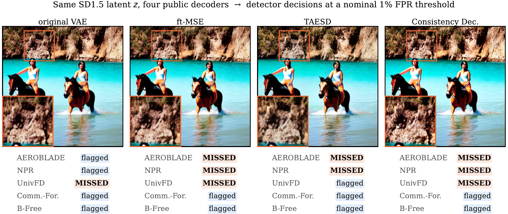

<h1 align="center">Same Latent, Different Verdict</h1>
<h3 align="center">The Role of Decoders in AI-Generated Image Detection</h3>

<p align="center">
<b>Irina Lebedeva</b> · Independent Researcher, Budapest<br>
<a href="https://irina-lebedeva.com">irina-lebedeva.com</a> · Paper: arXiv link coming soon
</p>

<p align="center">

</p>
<p align="center"><sub>One SD1.5 latent, four public decoders that read the same latent space. Below each image: each detector's decision at a threshold for a nominal 1% FPR, calibrated on independent photographs.</sub></p>

## What LatentLock tests

Detectors of AI-generated images are usually tested as if each generator were one fixed pipeline. In a latent diffusion model, though, the decoder that turns a latent into pixels can be swapped for a compatible public one without retraining anything. LatentLock locks the generated latent, changes only the decoder, and scores existing detectors at thresholds calibrated once on independent photographs.

## What we found

Decoder swaps alone change detector decisions, and not in the same direction for every detector: the same decoder can hide images from one detector and expose them to another. The effect replicates on SDXL, and AUROC understates it. Detectors that stay stable across decoders still flag nearly all real photographs passed once through the autoencoder, so stability alone does not show that a detector relies on generation-specific evidence. Full result tables are in the paper.

## Reproduce the main table in one command

The stored scores are enough to check Table 1 (TPR at 1% and 5% FPR for every detector and decoder) on a CPU, without a GPU, images or detector weights:

```
pip install numpy pandas
python reproduce_table1.py
```

It prints AUROC, TPR with the original decoder, the TPR drop for each alternative decoder (with 95% bootstrap intervals at 1% FPR), the flip rate and the all-decoder TPR. Thresholds are the 99th and 95th percentiles of the scores of 1,000 independent COCO calibration photographs. The output matches Table 1 of the paper.

## Repository layout

- `reproduce_table1.py`: Table 1 from the stored scores (numpy and pandas only).
- `code/`: generation, decoding and scoring pipelines (GPU), analysis and figure scripts (CPU), the reading rules fixed before the later experiments, and the environment (pip freezes, model revisions, weight checksums).
- `scores/`: per-image detector scores and run reports for every run in the paper (SD1.5 main run and pilot, SDXL, FLUX.1, JPEG and the add-on experiments).

Images are not included because of their size; every image is regenerated deterministically from the stored seeds and manifests. The full map from each table and figure to its script and data, the GPU commands with their requirements, model versions and the score-file format are in [REPRODUCIBILITY.md](REPRODUCIBILITY.md).

## Citation

```bibtex
@misc{lebedeva2026samelatent,
  title  = {Same Latent, Different Verdict: The Role of Decoders in AI-Generated Image Detection},
  author = {Lebedeva, Irina},
  year   = {2026},
  note   = {arXiv preprint}
}
```

## Licences

- Code and the per-image detector scores: MIT (see `LICENSE`).
- COCO captions and image ids in the manifests (`sources_manifest.json`, `calibration_manifest.json`, `flux_manifest.csv`, SDXL manifest): COCO annotations, © COCO Consortium, [CC BY 4.0](https://creativecommons.org/licenses/by/4.0/); not covered by the MIT licence.
- COCO photographs are not included in this repository. Each photograph keeps its own Flickr licence; see the [COCO terms of use](https://cocodataset.org/#termsofuse).
- Detectors, decoders and generators are used under the licences of their official releases.
